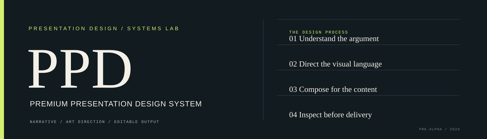

# PPD — Premium Presentation Design System

  

<strong>Presentations designed with intent. Not assembled from templates.</strong>

  
  
  
  
  

  <a href="#the-product">Product</a> ·
  <a href="#proof-of-direction">Proof</a> ·
  <a href="#what-works-today">What works</a> ·
  <a href="#architecture">Architecture</a> ·
  <a href="#development">Development</a> ·
  <a href="docs/ROADMAP.md">Roadmap</a>

---

## The product

**PPD (Premium Presentation Design System) is a quality-first system for creating original, visually distinctive and genuinely editable presentations.**

It treats presentation creation as a design process—not a single prompt-to-slides operation. The intended workflow analyses the audience and evidence, shapes the narrative, establishes a visual identity, composes each slide for its message, curates authentic assets, produces native PowerPoint objects and inspects the exported result.

Most automated slide tools optimise for the speed of the first draft. PPD is being developed around a different objective: **the quality of the finished presentation**.

> **Design the argument. Direct the visuals. Inspect every slide.**

## Why PPD

A frequent weakness of automated decks is not a lack of decoration. It is decoration without intent: repeated cards, unnecessary icons, invented marks, default gradients, irrelevant synthetic imagery and flattened diagrams.

PPD's design rules are deliberately different:

| Principle | Product rule |
|---|---|
| Narrative before layout | Understand the audience, purpose, evidence and argument before composing slides. |
| Art direction before decoration | Establish a deck-specific identity: typography, colour, grid, image treatment and visual rhythm. |
| Meaning before ornament | Do not add icons, fake logos, gradients or floating shapes merely to fill space. |
| Authentic visuals first | Prefer relevant, rights-cleared real imagery. AI-generated imagery is disabled by default in the product direction. |
| Composition, not template-filling | Match the composition to the information and communication task. |
| Editable by design | Preserve important text, diagrams, charts and shapes as native PowerPoint objects wherever practical. |
| Review before delivery | Render, inspect, critique, correct and verify the artifact before approval. |

## Proof of direction

The first milestone focuses on three different composition problems rather than a large library of generic templates.

  
  01 / Editorial opener — typographic hierarchy and visual restraint.

  
  02 / Data storytelling — native editable bars and explicitly illustrative values.

  
  03 / Technical architecture — editable nodes and connectors.

**[Download the editable three-slide PowerPoint proof](artifacts/ppd-three-concept-proof.pptx)**

**Data and scope note:** slide 2 uses synthetic demonstration values, not measured industry data. Slide 3 illustrates the intended target architecture, not a claim that every depicted subsystem is already implemented. These limitations are recorded in the source specifications.

## What works today

**Repository status: pre-alpha.** The lists below distinguish implemented code from the broader product direction.

### Implemented

- Renderer-independent TypeScript slide specification.
- Deterministic validation for required content, unique IDs, source references, image provenance, chart data and diagram relationships.
- Policy checks for AI-generated imagery, decorative icons and editability requirements.
- Explicit chart data status: verified or illustrative. Synthetic data produces a warning and must be labelled.
- Three JSON concept briefs: editorial opener, data story and technical architecture.
- Focused PptxGenJS proof renderer for those three concepts.
- Native editable PowerPoint text, shapes, bar elements, diagram nodes and connectors in the sample deck.
- Exported PPTX and rendered previews for review.
- Typecheck, validator tests, example validation and demo-build CI workflow.

### Not implemented yet

- AI-powered brief analysis, research or narrative generation.
- Image discovery, ingestion, provenance and licence-verification integrations.
- General-purpose automatic layout and composition generation.
- Arbitrary slide-spec rendering beyond the three proof compositions.
- General native chart and table generation.
- PDF export and cross-renderer fidelity verification.
- Rendered visual critique, anti-slop detection and automatic repair.
- Multi-agent design review and learned design preferences.

**PPD is not yet a complete presentation generator.** The current implementation proves a narrow but important foundation: structured slide specifications can be validated and rendered into a small editable PowerPoint artifact. The full design-intelligence system remains a roadmap, not a shipped claim.

## The first three concepts

| Concept | What it tests | Source specification |
|---|---|---|
| Editorial opener | Distinctive typography, hierarchy and restrained composition without synthetic hero imagery. | [01-cinematic-opener.json](examples/three-concepts/01-cinematic-opener.json) |
| Data storytelling | A visual argument with explicit units, interpretation and data provenance. | [02-data-storytelling.json](examples/three-concepts/02-data-storytelling.json) |
| Technical architecture | Valid relationships and an editable diagram rather than a flattened screenshot. | [03-technical-architecture.json](examples/three-concepts/03-technical-architecture.json) |

## Architecture

The long-term system uses a **shared structured slide specification** as its source of truth. Preview/PDF and native PowerPoint renderers consume the same content and design decisions, reducing divergence between what was approved and what gets delivered.

~~~mermaid
flowchart TD
  A[Brief, source material, data] --> B[Presentation intelligence]
  B --> C[Narrative specification]
  C --> D[Deck art direction]
  D --> E[Structured slide specification]
  E --> F[Asset research and curation]
  E --> G[Content-aware composition]
  F --> H[Preview and PPTX renderers]
  G --> H
  H --> I[Rendered inspection]
  I --> J{Quality gates pass?}
  J -- No --> K[Critique and repair]
  K --> G
  J -- Yes --> L[Verified output]
~~~

The current code covers the slide specification, deterministic validation and a focused PowerPoint proof renderer. The rest of the diagram describes the target architecture. See [docs/ARCHITECTURE.md](docs/ARCHITECTURE.md).

## Repository map

~~~text
.
├── .github/                 # CI, issue forms and PR template
├── assets/                  # PPD visual identity
├── artifacts/               # Editable PPTX proof and rendered previews
├── docs/                    # Vision, architecture, quality standards, roadmap
├── examples/three-concepts/ # Three structured slide briefs
├── src/
│   ├── cli/                 # Validate examples and build the proof deck
│   ├── core/                # Slide contract, validator and tests
│   ├── design/              # Initial design tokens
│   └── renderers/pptx/      # Focused editable PowerPoint renderer
├── CONTRIBUTING.md
├── LICENSE
├── README.md
└── package.json
~~~

## Development

### Requirements

- Node.js 20 or later
- npm

### Install

~~~bash
git clone https://github.com/jahwanthpulugujju-create/premium-presentation-design-system.git
cd premium-presentation-design-system
npm install
~~~

### Run the checks

~~~bash
npm run typecheck
npm test
npm run validate:examples
~~~

### Build the proof deck

~~~bash
npm run build:demo
~~~

The command writes `artifacts/ppd-three-concept-proof.pptx`. The renderer currently supports the three explicit proof compositions; it does not yet perform AI-driven layout selection or arbitrary deck generation.

### Run all checks

~~~bash
npm run check
~~~

## Engineering and design standards

- [Product vision](docs/PRODUCT_VISION.md) — problem, audience and product principles.
- [Architecture](docs/ARCHITECTURE.md) — shared slide model and renderer boundaries.
- [Design quality standard](docs/DESIGN_QUALITY_STANDARD.md) — visual and content rules.
- [Design reference method](docs/DESIGN_REFERENCE_METHOD.md) — extract principles without copying protected expression.
- [MVP acceptance criteria](docs/MVP_ACCEPTANCE_CRITERIA.md) — what each proof concept must demonstrate.
- [Quality model](docs/QUALITY_MODEL.md) — hard rejection rules and evaluation dimensions.
- [Roadmap](docs/ROADMAP.md) — implementation status and next milestones.
- [Implementation log](docs/IMPLEMENTATION_LOG.md) — verifiable development notes.

## Contributing

The project is early-stage. Contributions should improve design quality, editability, traceability or verification—not add decorative complexity. Read [CONTRIBUTING.md](CONTRIBUTING.md) before opening a pull request. Changes to slide output should include rendered evidence.

## Status

PPD is an independent, pre-alpha project. The product direction is ambitious; implementation is progressing in small, verifiable increments. Roadmap items remain unchecked until working code and reviewable output exist.

## License

PPD is released under the [MIT License](LICENSE). Third-party assets, fonts and reference materials retain their own licences and terms.
